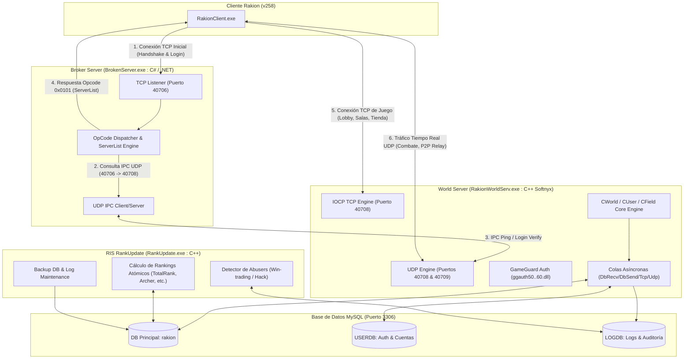

# Ingeniería Inversa Completa del Servidor Rakion v258
**Ruta analizada:** `C:\Rakion\v258\Server`  
**Fecha de análisis:** Octubre 2026  
**Documento técnico de arquitectura, funcionamiento interno e ingeniería inversa.**

---

## 1. Resumen Ejecutivo y Visión General de la Suite

El contenido de `C:\Rakion\v258\Server` corresponde a la arquitectura de servidor backend para **Rakion: Chaos Force** (versión 258, aproximadamente del año 2007 al 2010), el clásico juego de combate y acción multijugador en tercera persona desarrollado originalmente por la empresa surcoreana **Softnyx Co., Ltd.**

A través de la inspección estática, extracción de encabezados PE, análisis de cadenas (ASCII y UTF-16), desensamblado de código intermedio (CIL / .NET) y binarios nativos x86, se determina que esta carpeta no contiene un único ejecutable monolítico, sino un **ecosistema distribuido de 3 servidores/servicios especializados**, complementado por una base de datos relacional MySQL y librerías de protección anti-trampas:

| Componente | Archivo Principal | Tecnología / Compilador | Rol Principal |
| :--- | :--- | :--- | :--- |
| **Broker Server (Lobby Router)** | `BrokenServer\BrokenServer.exe` | C# / .NET Framework 4.0 Client Profile (Empaquetado con MPRESS, desarrollado por la comunidad / *CarlosX - XfsGames*) | Puerta de enlace TCP inicial para el cliente. Autentica al jugador, entrega la lista de servidores de juego (GameServers) y coordina mediante IPC. |
| **World Server (Game Server)** | `RakionWorldServ\RakionWorldServ.exe` | C++ Nativo (x86 MSVC 2003/2005, PDB original: `SoftnyxServerSuite_071119\RakionWorldServer`) | El núcleo del juego desarrollado por Softnyx. Corre como Servicio Windows NT o consola. Maneja sesiones (`CUser`), salas de combate (`CField`), inventario, combate, GameGuard, y base de datos con IOCP multihilo. |
| **Rank & Maintenance Server (RIS)** | `RIS_RakionUpdate\RankUpdate.exe` | C++ Nativo (x86 MSVC, PDB original: `Nileblue_Server\RankUpdate`, Agosto 2006) | Servicio por lotes para recálculo de rankings globales y por clase, detección de tramposos/abusers (win-trading), purga de logs y copias de seguridad de MySQL. |
| **Base de Datos** | `DB\rakion_all.sql` | MySQL (MyISAM / InnoDB) | Schema relacional de 61 tablas que modelan cuentas, personajes, items, clanes, loterías, economía y 26 tablas de auditoría. |
| **Módulos Anti-Cheat** | `RakionWorldServ\ggauth*.dll` | C++ DLLs (GameGuard CSAuth 5.0, 5.1, 5.2, 6.0 de INCA Internet) | Librerías de desafío/respuesta criptográfica contra clientes modificados o programas de trampas. |

---

## 2. Diagrama de Topología y Flujo de Comunicación



---

## 3. Análisis Profundo de `BrokenServer.exe` (Broker / Lobby Router)

### 3.1 Origen e Identificación
- **Desarrollador / Autor:** Identificado en la metadata del ensamblado como `CarlosX` perteneciente al grupo `XfsGames` (`http://www.xfsgames.com.ar`), un reconocido equipo de la comunidad de emulación de servidores privados para Rakion y GunBound.
- **Formato:** Ejecutable .NET compilado para `.NET Framework 4.0 Client Profile` (v4.0.30319).
- **Protección / Empaquetado:** Originalmente comprimido con **MPRESS** (compresor de ejecutables de MATCODE Software). El cargador extrae en tiempo de ejecución el código desensamblado utilizando una rutina de descompresión LZ (`lzmat`) y lo inyecta en memoria vía `System.Reflection.Assembly.Load`.
- **Desempaquetado exitoso:** Se logró la descompresión limpia de los 107 KB del ejecutable en el entorno de ingeniería inversa, exponiendo todos sus namespaces (`BrokenServer.Network`, `BrokenServer.Systems`, `BrokenServer.Global`).

### 3.2 Opcodes del Protocolo de Red de Rakion
`BrokenServer` implementa la máquina de estados inicial con la que habla el cliente de Rakion tras arrancar. En su método `BrokenServer.Systems::oPCode(Decode decode)` procesa los siguientes opcodes binarios recibidos:

1. **`0xCDDF` (Solicitud de Lista de Servidores / Server List Request):**
   - El cliente envía este opcode tras establecer la conexión TCP con el puerto 40706.
   - El Broker invoca `ServerListPacket(cliVersion)`.
   - Construye un paquete con el opcode de respuesta **`0x0101`** utilizando la clase `PacketWriter`.
   - El paquete contiene:
     - Cantidad total de GameServers configurados en `GameServers.ini`.
     - Por cada servidor: `ServerID`, `IP` (WAN o LAN según el flag `lan_wan`), `Port` (40708), estado (`Online/Offline/Busy`), `MaxSlots`, `UsedSlots` y el nombre en texto del servidor (por ejemplo, `WorldServer1`).
     - Al recibir esto, el cliente dibuja la pantalla de selección de servidores en el juego.

2. **Opcodes de Autenticación de Cuenta (`SV_AUTH_LOGIN`):**
   - El Broker reconoce 4 variantes de inicio de sesión según la subversión del cliente:
     - **`0x1310`:** `SV_AUTH_LOGIN` (Formato estándar v258).
     - **`0x3000`:** `SV_AUTH_LOGIN_2`.
     - **`0x5000`:** `SV_AUTH_LOGIN_3`.
     - **`0x4000`:** `SV_AUTH_LOGIN_4`.
   - Extrae el `UserID` y la `Password` (o hash MD5) de los datos del paquete con `PacketReader`.
   - En lugar de consultar directamente la base de datos SQL, el Broker delega la autenticación al `RakionWorldServ` mediante su canal IPC para garantizar consistencia de sesión.

### 3.3 Protocolo IPC (Inter-Process Communication) sobre UDP
Para comunicarse con uno o más `RakionWorldServ`, `BrokenServer` implementa un canal IPC UDP en el puerto 40706/40708:
- **Estructura del paquete IPC:**
  - Encabezado con comando IPC (`IPCCommand`).
  - Puerto de destino / ID de secuencia.
  - Carga útil (*payload*).
  - Cifrado simétrico XOR dinámico (`IPCenCode` / `IPCdeCode`) mediante clave rotativa.
  - Checksum de integridad de 1 byte al final calculado con el algoritmo `BCRC`.
- **Comandos IPC implementados:**
  - `IPC_REQUEST_SERVERINFO` (0x01): Solicita al WorldServer su estado de concurrencia.
  - `IPC_INFO_SERVER` (0x02): El WorldServer responde reportando: `MAXUSER`, `CUR` (usuarios conectados actuales), `MAXSALAS` (salas máximas, ej. 2000), `CURSALAS` (salas en uso) y versión. Si un servidor deja de responder pings, el Broker lo marca automáticamente como `Offline`.
  - `IPC_REQUEST_LOGIN` (0x03): El Broker le pide al WorldServer que verifique si el usuario y contraseña son válidos y si tiene ban activo.
  - `IPC_INFO_LOGIN` (0x04): El WorldServer responde con el código de resultado (`wResult`: 0 = Éxito, códigos de error para contraseña incorrecta, cuenta no existente, baneo temporal o permanente) y la razón del ban (`sBanReason`).

---

## 4. Análisis Profundo de `RakionWorldServ.exe` (World Server)

### 4.1 Naturaleza Binaria y Origen
- **Compilador:** Microsoft Visual C++ versión 7.1 / 8.0 (MSVC 2003/2005), 32-bit (x86).
- **Ruta PDB del compilador original:**
  ```text
  d:\Rakion\Debug\SoftnyxServerSuite_071119\RakionWorldServer\Release\RakionWorldServer.pdb
  ```
  Esto confirma de forma irrefutable que es el código fuente oficial compilado por **Softnyx** el **19 de Noviembre de 2007** (Build `071119`).
- **Arquitectura de Servicio Windows:**
  El ejecutable implementa las APIs de Service Control Manager de Windows (`ADVAPI32.dll`):
  - `StartServiceCtrlDispatcherA`
  - `RegisterServiceCtrlHandlerA`
  - `SetServiceStatus`
  - Admite los parámetros en línea de comandos:
    - `-install`: Registra el servicio `Rakion World` en el registro de Windows (`OpenSCManagerA`, `CreateServiceA`).
    - `-uninstall`: Desinstala el servicio (`DeleteService`).
    - `-start`: Inicia la ejecución del servicio (`StartServiceA`).
    - `-stop`: Envía la señal de parada (`ControlService`).
    - Si se ejecuta directamente sin banderas, corre de forma interactiva en modo consola (`Subsystem: Windows CUI`).

### 4.2 El Motor de Red `PerfLib` (High-Performance IOCP Framework)
El servidor utiliza una biblioteca de alto rendimiento diseñada por los ingenieros de Softnyx llamada **`PerfLib`**, cuyos símbolos RTTI en C++ fueron completamente recuperados:
- `PerfLib::IoCompletionPort`: Capa orientada a objetos sobre los **I/O Completion Ports (IOCP)** del kernel de Windows (`CreateIoCompletionPort`, `GetQueuedCompletionStatus`, `PostQueuedCompletionStatus`). Utiliza hilos de trabajo (*worker threads*) ajustados a la cantidad de núcleos de la CPU para evitar el cuello de botella de sondeo (*polling*) o `select()`.
- `PerfLib::TcpSocket`: Maneja conexiones TCP orientadas a conexión con Windows Sockets 2 (`WS2_32.dll`) y extensiones de Microsoft (`MSWSOCK.dll`), empleando la llamada asíncrona `AcceptEx` y `GetAcceptExSockaddrs` para aceptar cientos de jugadores concurrentes sin latencia.
- `PerfLib::UdpSocket`: Maneja el socket UDP no bloqueante con `WSASendTo` y `WSARecvFrom`.
- `PerfLib::IPv4Address`: Abstracción de encapsulado y parseo de estructuras `sockaddr_in`.
- `PerfLib::AsyncWebRequest`: Cliente HTTP asíncrono basado en `WININET.dll` (`InternetOpenA`, `HttpOpenRequestA`, `HttpSendRequestA`) utilizado para validar cuentas contra sistemas web externos (`/auth.asp`).

### 4.3 Arquitectura de Red Híbrida: TCP + Doble UDP
`worldserver.ini` define puertos y colas específicas:
- **Puerto TCP 40708:** Canal de control y persistencia fiable. Todo lo crítico pasa por TCP:
  - Autenticación y selección de personaje.
  - Creación y listado de salas de juego (`(71) NetworkMessageFieldList`, `(83) NetworkMessageFieldCreate`, `(79) NetworkMessageFieldQuickEnter`).
  - Chat de lobby y chat de sala (`(127) NetworkMessageFieldChat`).
  - Transacciones de tienda, inventario, compra de items y herrería.
- **Doble Puerto UDP (Port1: 40708, Port2: 40709):**
  - Dos colas de trabajo: `UDP1Q` y `UDP2Q`, con un pool de buffers preasignado (`SendPoolCount=50`).
  - **¿Por qué dos puertos UDP?** Rakion combina un modelo Peer-to-Peer (P2P) directo entre clientes para la sincronización fina de animaciones y golpes con un sistema de retransmisión (*relay*) por el servidor para jugadores detrás de NAT/Firewall estricto (UDP1 para datos de control/heartbeat del cliente y UDP2 para el flujo de estado de combate y sincronización de entidades).

### 4.4 Lógica de Servidor de Juego (`CWorld`, `CUser`, `CField`)
El código interno organiza la lógica en 3 entidades maestras:
1. **`CWorld` (Controlador Central del Mundo):**
   - Coordina los ciclos de inactividad (`CWorld::Idle`), las desconexiones limpias o forzadas (`CWorld::ProcessUserDisconnect`, `NetworkMessageDisconnect`), y la comunicación con la base de datos (`CWorld::DBCommandLogin1`).
   - Mantiene la tabla hash en memoria de todos los usuarios conectados y todas las salas abiertas.
2. **`CUser` (Sesión y Estado del Jugador):**
   - Rastrea el estado del cliente: conexión, autenticación, canal actual (`CUser::SetChannelInfo`), personaje activo, inventario en memoria y validaciones de acción.
   - **Herrería / Refinamiento (`CUser::CheckEnchantReinforce`):** Contiene la lógica del juego donde los items nivel 1 a 3 están protegidos contra rotura (*"Not Destroy below lv3 Item!!"*), mientras que a niveles superiores se aplican probabilidades matemáticas de éxito, retroceso de nivel o destrucción del item.
   - Manejo de experiencia de criaturas / cells (`CUser::ulItemExp`, `CUser::byItemLevel`) y oro por venta (`CUser::ulSellGold`).
3. **`CField` (Salas de Batalla y Escenarios):**
   - Representa las salas de juego (máximo 2000 salas concurrentes según `MaxField=2000`).
   - Modos soportados en el binario:
     - Solo Deathmatch (Todos contra todos).
     - Team Deathmatch (Combate por equipos).
     - Leader Wars (Batalla de líderes / Proteger al líder).
     - Golem Wars (Guerra de Golems / Destrucción de la espada dorada).
     - Boss Raid (Cacería de jefes).
     - Stage Mode (Misiones cooperativas PVE de escenarios).
   - Arbitraje de muertes: `CField::GameDiePlayer`. Registra qué jugador mató a quién, con qué causa y en qué modo, escribiendo en `LogDiePlayer`.
   - Sistema de votación para expulsar jugadores molestos o tramposos (`OnVote`, `BanSlot`).

### 4.5 Pool Elástico de Base de Datos y Colas de Mensajes
Para evitar que las consultas SQL bloqueen la simulación de juego:
- **`[FlexDbConn]`:** Implementa un pool dinámico de conexiones (`MaxDbConnection=50`, `DbConnAdjustFreq=50`). Si la carga de usuarios sube, el servidor incrementa automáticamente los sockets a MySQL; si la carga baja, los libera para no saturar el servidor MySQL.
- **División de 3 Esquemas:**
  - `[DB]`: Datos principales del mundo de juego.
  - `[USERDB]`: Autenticación y cuentas de usuario.
  - `[LOGDB]`: Base de datos de telemetría de alto volumen (evita que los `INSERT` masivos de logs frenen las lecturas de los jugadores).
- **Colas Asíncronas de E/S:**
  - `DbRecvQueue` (100) y `DbSendQueue` (100): Peticiones y respuestas SQL desacopladas del hilo de red.
  - `TcpRecvQueue` (50) y `TcpSendPoolSize` (50).
  - `UdpRecvQueue` (50).

### 4.6 Seguridad, GameGuard y Parches Detectados
- **GameGuard (INCA Internet):**
  - El servidor lee `csauth2.cfg` (que contiene las versiones activas: `50 51 52`).
  - Carga dinámicamente las DLLs de protección: `ggauth50.dll`, `ggauth51.dll`, `ggauth52.dll`, `ggauth60.dll`.
  - Exporta e invoca: `PrtcGetAuthQuery`, `PrtcCheckAuthAnswer`, `PrtcEncryptQuery`, `PrtcDecryptAnswer`.
  - El servidor envía consultas periódicas al cliente y valida que el GameGuard local del jugador devuelva la respuesta matemática cifrada correcta. Si no coincide o expira el tiempo, el servidor ejecuta la desconexión inmediata.
- **Diferencias entre `RakionWorldServ.exe` y `old\RakionWorldServ.exe` (Ingeniería Inversa del Parche):**
  Al comparar byte a byte ambos ejecutables, se identificaron **59 bytes de diferencia clave**:
  1. **Parche de Código Binario en `0x0002C6B8`:**
     - Original (`old`): `80 BC 3A 7C 23 00 00 02 0F 84 89 00 00 00` (`cmp ..., 2; je +0x89`).
     - Modificado (actual): `80 BC 3A 7C 23 00 00 02 E9 8A 00 00 00 90` (`cmp ..., 2; jmp +0x8A; nop`).
     - **Significado técnico:** Se forzó un salto incondicional (`jmp`) anulando una comprobación condicional. Este es el clásico crack/bypass utilizado en la escena de servidores privados de Rakion para deshabilitar la validación estricta de GameGuard o la verificación de licencia del ejecutable.
  2. **Parche de Cadenas de Texto IP en `0x0004B9F4` y `0x0004CC20`:**
     - Original (`old`): Cadena ASCII `89.46.37.250` (la IP pública del servidor original donde estuvo alojado).
     - Modificado (actual): Cadena ASCII `192.168.1.6` (modificada directamente en los datos binarios para permitir juego en red local o bind de loopback sin pasar por DNS).

---

## 5. Análisis Profundo de `RankUpdate.exe` (RIS - Rakion Information System)

### 5.1 Origen y Rol
- **Compilador:** Microsoft Visual C++ Runtime Library, x86.
- **PDB original:**
  ```text
  c:\Nileblue_Server\RankUpdate\RankUpdate\Release\RankUpdate.pdb
  ```
  *(Nota histórica: "Nileblue" fue el nombre clave interno en Softnyx para el proyecto Rakion).*
- **Fecha de compilación:** 22 de Agosto de 2006.
- **Propósito:** No atiende clientes directamente. Es un daemon de backend programado para ejecutarse periódicamente (definido por `ProcessTime=24` horas en `Config.ini`) para procesar tareas computacionalmente pesadas que degradarían el rendimiento del WorldServer si se ejecutaran en línea.

### 5.2 Tareas Automatizadas que Ejecuta
1. **Recálculo y Generación Atómica de Tablas de Ranking:**
   - Lee todos los personajes activos en los últimos meses (`lastconnect > SUBDATE(now(), INTERVAL 2 MONTH)`).
   - Calcula los rankings individuales, globales y por cada una de las 5 clases:
     - `TotalRank` (Ranking general).
     - `SwordmanRank` (Espadachín).
     - `ArcherRank` (Arquera).
     - `BlacksmithRank` (Herrero).
     - `MageRank` (Mago).
     - `NinjaRank` (Ninja).
     - `ClanRank` (Ranking de Clanes por puntos).
   - **Técnica de Doble Buffer (Double-Buffering SQL):**
     Para que el juego nunca se quede sin datos de ranking ni sufra bloqueos de tablas mientras calcula cientos de miles de registros:
     ```sql
     CREATE TABLE IF NOT EXISTS `TotalRank` ...
     -- Inserta y calcula todos los datos ordenados por EXP DESC
     ALTER TABLE TotalRank RENAME TotalRankP;
     ```
     El servidor de juego consulta `TotalRankP`, permitiendo que la rotación de datos sea instantánea e imperceptible para los usuarios.
   - **Asignación de Grados (Badges/Medallas):**
     Aplica las reglas de experiencia de Rakion para otorgar las insignias de nivel/rango:
     - Grado 26: EXP < 1,000
     - Grado 25: EXP 1,000 - 2,499
     - Grado 24: EXP 2,500 - 3,999
     - Grado 23: EXP 4,000 - 5,999
     - Grado 22: EXP 6,000 - 7,999
     - Grado 21: EXP 8,000 - 10,499
     - Grado 20: EXP 10,500 - 12,999
     - Grado 19: EXP 13,000 - 16,999
     - Grado 18: EXP 17,000 - 19,999
     - Grado 17: EXP 20,000 - 23,999
     - Grado 16: EXP 24,000 - 27,999
     - Grado 15: EXP 28,000 - 31,999
     - Grados superiores (14 a 1): distribuidos por percentiles y posiciones fijas del ranking.

2. **Detección Automática de Tramposos y Cuentas Arregladas (`ABUSER`):**
   - Configurado en `Config.ini`:
     ```ini
     [ABUSER]
     CheckDay=1
     CheckWinSum=200
     CheckExpSum=6000
     CheckGoldSum=12000
     ```
   - Ejecuta una consulta analítica de agrupación sobre los registros de partidas del último día:
     ```sql
     INSERT INTO LogFieldGameAbuserCheck(charid, charname, poweruser, win, loss, exp, gold, createtime)
     SELECT charid, charname, poweruser, SUM(win), SUM(loss), SUM(exp), SUM(gold), NOW()
     FROM LogFieldGamePointList
     WHERE createtime > SUBDATE(NOW(), INTERVAL 1 DAY)
     GROUP BY charname
     HAVING (SUM(win) >= 200 OR SUM(exp) >= 6000 OR SUM(gold) >= 12000);
     ```
   - Si un jugador acumuló más de 200 victorias, 6,000 de experiencia o 12,000 de oro en 24 horas, queda marcado como presunto infractor de *win-trading* o *level-hack* en `LogFieldGameAbuserCheck` para baneo automático o revisión del Game Master.

3. **Mantenimiento y Purga de Logs:**
   - Trunca tablas de telemetría de alta frecuencia como `LogFieldGamePointList` una vez consolidado el análisis para evitar que el disco se llene.
   - Ejecuta las rutinas `DeleteUnusedLogDay` y `DeleteUnusedLogMonth`.

4. **Copia de Seguridad de Archivos de Base de Datos (`DBBACKUP`):**
   - Lee `SRC` y `DEST` en `Config.ini` y copia a nivel de sistema de archivos las tablas físicas de MySQL (`.frm`, `.MYD`, `.MYI`) de la base de datos `rakion`.

---

## 6. Modelo de Datos y Esquema MySQL (`rakion_all.sql`)

El archivo SQL contiene **61 tablas** diseñadas para MySQL. Sus módulos principales son:

### 6.1 Módulo de Usuarios y Seguridad
- **`user`:** Contiene las credenciales principales: `id` (nombre de usuario, máx 11 caracteres), `password` (texto plano o hash MD5), `e_mail`, `country` (código de país para banderas), `Authority` (0 = usuario normal, valores superiores = Game Master / Administrador).
- **`usergameinfo`:** Estado de la cuenta en el juego: `gold`, `tutorial`, `slot` (cantidad de personajes desbloqueados, default 4), `bag` (bolsas de inventario activas), `bandate` y `ban` (bloqueo de cuenta), `clanid`, `powertime` y `powerlevelpoint` (suscripción PowerUser).
- **`cash`:** Saldo de dinero real / Cash de la cuenta.

### 6.2 Módulo de Personajes y Atributos
- **`characterinfo`:** Contiene los avatares creados:
  - `Class`: 0 = Swordman, 1 = Archer, 2 = Blacksmith, 3 = Mage, 4 = Ninja.
  - Atributos base y asignados: `hit1` a `hit4` (daño de ataques básicos), `chit` (daño especial/crítico), `hp` (vida), `ap` (armadura), `attackspeed` (velocidad de ataque), `speed` (velocidad de carrera), `maxcp` (puntos de célula / Cell Points para invocar criaturas).
  - `level`, `exp`, `levelpoint` (puntos sin repartir), `win`, `lose`, `draw`, `rankgrade`, `totalrank`, `classrank`.
  - `deletekey`: Clave de seguridad para borrado (default `sirmaster`).

### 6.3 Módulo de Objetos, Inventario y Criaturas
- **`iteminfo`:** Catálogo maestro de items (armas, cascos, pecheras, hombreras, anillos, collares, pociones y criaturas/cells). Contiene precio en oro, precio en cash, nivel mínimo requerido, clase compatible y estadísticas que otorga.
- **`useriteminfo`:** Instancias de items que pertenecen a los jugadores. `slot` (posición en la bolsa), `level` (nivel de refinado/encantamiento de la forja), `exp` (experiencia acumulada por criaturas convocadas para subir de nivel), `limittime` (minutos restantes para items rentados/temporales o 0 si es permanente).
- **`pendingpresents` / `logpresent`:** Sistema de regalos entre jugadores o entregas de eventos de la administración.

### 6.4 Módulo de Clanes y Sistema Social
- **`claninfo`:** Datos del clan: `masterid`, `mastername`, `name`, `point` (puntos ganados en Clan Wars), `members`, `rank`.
- **`clanschedule`:** Desafíos y batallas programadas entre clanes.
- **`buddylist`:** Lista de amigos de cada usuario.

### 6.5 Módulo de Auditoría y Telemetría (Logging)
Consta de **26 tablas con prefijo `log*`** que registran cada microtransacción y evento:
- `loguserconnect`: Conexiones, IP real, país, hora de entrada y salida.
- `logbuycashitem`, `logbuypoweruser`, `logspendgoldcash`: Flujo financiero y compras en tienda.
- `logdieplayer`: Cada baja en combate (asesino, víctima, modo, causa de muerte).
- `logstageclear`, `logstageclearp`: Puntuación y rango (S, A, B, C) al completar misiones cooperativas.
- `logcharstateclear`: Reseteo de puntos de estadísticas.
- `logdeletecharacter`: Auditoría de personajes borrados.
- `loglottery` / `lotto`: Apuestas del sistema de lotería de la taberna.

---

## 7. Configuración y Parámetros Operativos

Para levantar el entorno completo se requiere orquestar los archivos de configuración:

### `worldserver.ini`
- `[Server]` `Port=40708`: Puerto TCP donde los clientes juegan.
- `[Broker]` `IP=192.168.1.5`, `Port=40706`: Dirección del `BrokenServer`.
- `[DB]`, `[USERDB]`, `[LOGDB]`: Credenciales MySQL (usuario `root`, clave `123456`, host `localhost`, puerto `3306`).
- `[UDP]` `Port1=40708`, `Port2=40709`: Puertos de paquetes en tiempo real.
- `[Client]` `MD5_1=D`, `MD5_2=709F1058DC30EB19761F55C82104D235`: Hash MD5 esperado del ejecutable `Rakion.bin` del cliente. Si no coincide, el servidor rechaza la conexión.

### `BrokenServer\Settings\Settings.ini` y `GameServers.ini`
- `Settings.ini`: Define el puerto de escucha del Broker (`ip=192.168.1.5`, `port=40706`).
- `GameServers.ini`: Define la lista de mundos disponibles que el cliente verá en pantalla, vinculando su IP local, IP WAN y puerto de juego (40708).

### `RIS_RakionUpdate\Config.ini`
- `ProcessTime=24`: Frecuencia de cálculo de rangos en horas.
- `CheckWinSum`, `CheckExpSum`, `CheckGoldSum`: Umbrales de detección de tramposos.
- `SRC` y `DEST`: Rutas de respaldo físico de la base de datos.

---

## 8. Conclusiones y Diagnóstico Técnico

1. **Estado del Paquete:** Es un servidor funcional y completo de la versión v258 de Rakion. Posee tanto el núcleo oficial de Softnyx (`RakionWorldServ.exe` y `RankUpdate.exe`) como la solución de la comunidad para sustituir el Broker original ausente (`BrokenServer.exe`).
2. **Nivel de Modificación:** El WorldServer posee un parche binario en la dirección `0x0002C6B8` que reemplaza un salto condicional por incondicional para evitar la exigencia de GameGuard oficial o licenciamiento corporativo, además de IPs preconfiguradas para entorno LAN (`192.168.1.x`).
3. **Puntos Críticos para Despliegue:**
   - La base de datos requiere MySQL 5.0 / 5.1 o MariaDB en modo de compatibilidad (debido a campos `datetime NOT NULL default '0000-00-00 00:00:00'` y tablas MyISAM).
   - `BrokenServer.exe` requiere el runtime de .NET Framework 4.0 o superior instalado en el sistema operativo.
   - Si se cambia la IP de la máquina anfitriona, deben sincronizarse los archivos `worldserver.ini`, `Settings.ini` y `GameServers.ini`.

