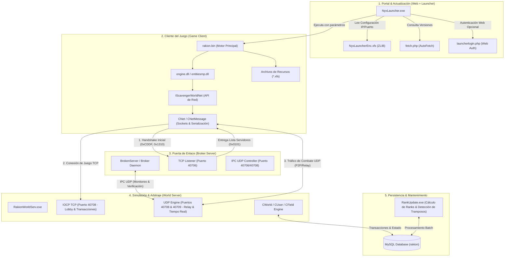

# Arquitectura Integral del Ecosistema Rakion v258
**Proyecto:** `rakion-brokenyx`  
**Ruta del Proyecto:** `C:\Users\Alexis\Projects\C#\rakion-brokenyx`  
**Objetivo:** Especificación técnica completa del ecosistema (Cliente, Launcher, Web, Servidores y Protocolos) para la reimplementación limpia y orgánica de un emulador de servidor en C# moderno (.NET 10 LTS), prescindiendo de parches binarios y hacks heredados.

---

## 1. Visión Holística del Ecosistema

El universo técnico de Rakion (v258 / RIS Ver 1026) funciona como un sistema distribuido de cinco capas acopladas:



---

## 2. Anatomía del Cliente (`rakion.bin`, DLLs y Recursos)

### 2.1 El Núcleo del Cliente
El cliente de Rakion en su versión v258 está compuesto por:
- **`rakion.bin`:** En realidad es un ejecutable PE32 nativo x86 renombrado a extensión `.bin` para evitar que el usuario lo abra directamente sin el launcher.
  - En la carpeta `BinDev` de la auditoría se localiza el **binario totalmente desempacado** (1.8 MB frente a los 848 KB del binario protegido del cliente), libre de la compresión ASProtect/Themida original.
  - Su código expone de forma directa la tabla de métodos virtuales (vtable) y nombres desensamblados de la interfaz maestra de red: **`IScavengerWorldNet`**.
- **`engine.dll` (Motor Gráfico y Físico):** Desarrollado sobre una evolución del motor Serious Engine adaptado por Softnyx para combate cuerpo a cuerpo y tercera persona en arenas.
- **`entitiesmp.dll` & `gamemp.dll`:** Entidades de juego (clases de personajes, criaturas invocables/cells, proyectiles, espadas, cajas de colisión y sincronización multijugador).
- **`Buddy2.dll`:** Subsistema de mensajería social, amigos y chat fuera de partida.

### 2.2 La Interfaz de Red del Cliente: `IScavengerWorldNet`
A través de la ingeniería inversa de los símbolos en `BinDev\rakion.bin`, se ha reconstruido el mapa exacto de funciones que el cliente invoca para comunicarse con el servidor. Este es el contrato que nuestro nuevo servidor en C# debe satisfacer al 100%:

| Categoría | Método en `rakion.bin` | Parámetros Binarios | Propósito en el Juego |
| :--- | :--- | :--- | :--- |
| **Sesión / Login** | `SendLogin` | `(char* user, char* pass, uint16 ver, char* ip, uint8 flag)` | Handshake y autenticación inicial. |
| | `SendAlive` | `()` | Heartbeat / Ping de mantenimiento de sesión. |
| | `SendGameGuard` | `(uint8* responseData)` | Respuesta a la consulta de seguridad. |
| **Personajes** | `SendCharacterSelect` | `(uint32 charId)` | Selección del personaje para entrar al Lobby. |
| | `SendCharacterCreate` | `(char* name, uint8 classId, uint8 slot)` | Creación de personaje (0=Swordman, 1=Archer, 2=Blacksmith, 3=Mage, 4=Ninja). |
| | `SendCharacterDelete` | `(uint32 charId, char* deleteKey)` | Borrado de personaje con clave de seguridad. |
| | `SendCharacterStateClear`| `(uint8 slot, uint16 cost)` | Reseteo de puntos de estadísticas. |
| | `SendCharacterTutorialClear`| `()` | Marca el tutorial completado (+oro/exp). |
| | `SendCharacterChangeCharName`| `(char* newName, uint8 slot, uint16 cost)` | Cambio de nombre con pergamino. |
| **Canales / Lobby** | `SendChannelList` | `(uint8, uint8)` | Solicita canales (Principiante, Libre, Clan). |
| | `SendChannelEnter` | `(uint8 channelId, char* pass)` | Ingreso a un canal específico. |
| | `SendChannelExit` | `()` | Salida del canal. |
| | `SendChannelChat` | `(char* text)` | Mensaje enviado al chat global del canal. |
| **Salas (Fields)** | `SendFieldList` | `(...)` | Obtiene lista paginada de salas de batalla. |
| | `SendFieldCreate` | `(char* name, char* pass, uint8 mode, uint8 map, ...)` | Crea sala con reglas, modo y mapa. |
| | `SendFieldEnter` | `(uint16 fieldId, char* pass)` | Entra a una sala de juego. |
| | `SendFieldReady` | `(uint8 isReady)` | Cambia estado a Preparado (Ready) / No Preparado. |
| | `SendFieldQuickEnter` | `()` | Entrada rápida por emparejamiento. |
| | `SendFieldChat` | `(char* text)` | Chat de la sala de espera. |
| | `SendFieldGameStart` | `()` | El host inicia la cuenta regresiva. |
| **Combate** | `SendFieldGameRoundStart`| `()` | Inicia la ronda tras cargar mapa y modelos. |
| | `SendFieldGameDiePlayer`| `(uint8 victimSlot, uint8 cause)` | Notifica que un jugador ha muerto y el motivo. |
| | `SendFieldGameRoundEnd` | `(uint8 winningTeam)` | Finaliza la ronda y muestra puntuaciones. |
| | `SendFieldGameEnd` | `()` | Finaliza la partida completa. |
| | `SendFieldGamePoint` | `(uint32 exp, uint32 gold, ...)` | Reporta puntos acumulados al servidor arbitral. |
| | `SendFieldGameStagePoint`| `(...)` | Puntuación en escenarios PVE. |
| | `SendFieldGameMasterBossHP`| `(uint8 bossId, uint16 hp)` | Sincroniza vida del jefe en Boss Raid. |
| | `SendFieldGameMasterGolem` | `(uint16 team, uint16 hp)` | Sincroniza vida de los Golems en Golem Wars. |
| **Inventario & Tienda**| `SendInventoryEnter` | `()` | Abre la interfaz de inventario. |
| | `SendInventoryBuy` | `(uint16 itemId, uint8 type, uint8 period, uint16 price)` | Compra de items por oro o cash. |
| | `SendInventorySell` | `(uint8 slot)` | Venta de un item de la bolsa. |
| | `SendInventoryMove` | `(uint8 srcSlot, uint8 dstSlot, ...)` | Reorganiza items en las bolsas. |
| | `SendEncahntReinforce`| `(uint8 slot, uint8 gemSlot, ...)` | Herrería: refinado y encantamiento de items. |
| | `SendInventoryAllocationPoint`| `(uint8 statIndex)` | Distribuye un punto de estadística subido. |
| | `SendPresentPeek/Accept`| `(uint32 presentId, ...)` | Sistema de recepción de regalos. |
| **Red P2P & Relay** | `SendFieldGameTunnelingOne`| `(uint16 targetSlot, CNetMessage& msg, uint8)` | Enrutamiento de paquetes UDP vía servidor. |
| | `SendFieldGameTunnelingAll`| `(uint16 fieldId, char* data)` | Broadcast UDP a todos los miembros de la sala. |
| | `SetRelayIP / SetRelayPort`| `(uint32 ip, uint16 port)` | Configuración de servidor de relevo de paquetes. |

### 2.3 Serialización Binaria: `CNetMessage`
El motor del cliente empaqueta sus mensajes mediante el flujo de operadores `<<` y `>>` sobre la clase `CNetMessage`:
```cpp
CNetMessage& operator<<(const unsigned char&);   // uint8
CNetMessage& operator<<(const unsigned short&);  // uint16
CNetMessage& operator<<(const unsigned long&);   // uint32
```
Los paquetes tienen una estructura estándar:
- **Header:** Longitud del mensaje (uint16) + Opcode de comando (uint16).
- **Body:** Parámetros primitivos empaquetados en Little-Endian.
- **Strings:** Prefijadas por su longitud en bytes o terminadas en `\0` (según el opcode).

### 2.4 El Sistema de Archivos `.xfs` (eXtended File System)
Los recursos del cliente no están sueltos en disco, sino empaquetados en archivos `.xfs` (`DataSetup.xfs`, `Classes.xfs`, `ModelsSV.xfs`, etc.).
- La herramienta `edit.exe` de la auditoría es **iXFS v1.0** (desarrollada por CarlosX).
- **Formato interno XFS2:**
  - Encabezado con firma y punteros a la tabla de ficheros.
  - Compresión de bloques usando **ZLIB** estándar (`78 9C` magic bytes).
  - Cifrado simétrico de datos clave (`characterdata.dat`, tablas de configuración de armas y criaturas).

---

## 3. El Subsistema de Lanzador y Web (`Launcher`, `fetch.php`)

El cliente oficial nunca se iniciaba solo; requería de la suite web y el lanzador:

### 3.1 `NyxLauncherEnc.xfs` (Descifrado e Identificado)
Al desempacar este archivo con ZLIB, se reveló la configuración que conecta el lanzador con la infraestructura:
```ini
[NyxLauncher]
Url_Fetch=http://192.168.1.5/fetch/fetch.php
Ip=192.168.1.5
Port=40706

[Rakion]
Url_Fetch=http://192.168.1.5/fetch/fetch.php
```
Aquí se define exactamente a qué IP y puerto debe conectarse el cliente para encontrar el Broker (`Port=40706`).

### 3.2 Protocolo de Auto-Actualización (`fetch.php`)
Cuando `NyxLauncher` arranca, invoca:
`GET /fetch/fetch.php?11001&<version_actual>` (AppID 11001 = Rakion).
El script consulta las tablas `fetchapp` y `fetchfile` de MySQL. Si `VerLimit > version_actual`, responde con el protocolo plano de Softnyx:
- `+<NoticeUrl>`: URL de la ventana de noticias HTML.
- `=<FileUrl>`: URL base donde descargar los parches.
- `~<Count>;<TotalSize>;<VerLimit>`: Cantidad de archivos a actualizar y versión final.
- Lista de acciones: `<Comando>;<Directorio>;<Archivo>;<Versión>;<Tamaño>`.

### 3.3 El Lanzador de Comunidad (`load.bin` / `FixLaunch`)
En la carpeta `audit` encontramos que la comunidad diseñó:
- **`load.bin`:** Un cargador en .NET (`RakionLauncher.exe`) comprimido con MPRESS que inyecta parámetros y ejecuta `rakion.bin` eludiendo la necesidad de parches web obligatorios.
- **`FixLaunch`:** Utilidad en C# que escribe en el registro de Windows `HKLM\SOFTWARE\Softnyx\Rakion` (`Location` y `Version`) para que cualquier ejecutable encuentre las rutas del juego.

---

## 4. Auditoría de Parches y Hacks: ¿Por qué existían y cómo prescindir de ellos?

En la versión clásica de RageZONE / XfsGames, para hacer funcionar el servidor se aplicaron una serie de "parches de emergencia" sobre binarios compilados porque no se disponía del código fuente original:

| Hack / Parche Antiguo | ¿Dónde se aplicó? | ¿Por qué se hizo? | Solución en nuestro Servidor Limpio en C# |
| :--- | :--- | :--- | :--- |
| **Parche de Salto `0x0002C6B8`** (`0F 84` -> `E9 8A .. 90`) | `RakionWorldServ.exe` | Forzó un salto incondicional en ensamblador para que el servidor ignorara la falta de comunicación con los servidores de licencia y GameGuard de INCA Internet. | **Innecesario:** Nuestro servidor C# no implementa rutinas obsoletas de GameGuard; responderá los paquetes que el cliente espera de forma nativa sin validaciones externas que fallen. |
| **Hardcoding de IP local** (`89.46.37.250` -> `192.168.1.6`) | `RakionWorldServ.exe` | Modificación con editor hexadecimal en los datos del ejecutable porque el WorldServer no leía ciertas IPs dinámicamente desde el `.ini`. | **Innecesario:** Toda la configuración de red en C# se gestionará en un `appsettings.json` elástico y dinámico, con soporte para `0.0.0.0`, LAN, WAN y DNS público. |
| **MD5 Checks forzados** (`MD5_1`, `MD5_2`) | `worldserver.ini` | Softnyx obligaba al servidor a contrastar el hash MD5 exacto de `rakion.bin`. Si el usuario modificaba un byte del cliente, el servidor lo desconectaba. | **Control Total:** Podemos configurar el servidor para que acepte hashes específicos o deshabilitar la comprobación para permitir clientes con mejoras visuales, traducciones o resolución panorámica. |
| **`BrokenServer.exe` (MPRESS .NET)** | Carpeta `BrokenServer` | Como no había código del Broker original, se programó un emulador en C# pero se ofuscó y empaquetó con MPRESS. | **Unificación:** Construiremos un Broker transparente y de código abierto en C# integrado directamente en la solución. |

---

## 5. El Protocolo de Comunicación Cliente-Servidor (Paso a Paso)

Para lograr un emulador limpio, el flujo de conexión debe operar según las siguientes fases:

```mermaid
sequenceDiagram
    autonumber
    actor Player as Jugador (Cliente Rakion)
    participant Broker as Rakion.Broker (TCP 40706)
    participant World as Rakion.World (TCP 40708)
    participant DB as MySQL (rakion)
    participant Relay as Rakion.Relay (UDP 40708/40709)

    Note over Player, Broker: Fase 1: Handshake y Selección de Servidor
    Player->>Broker: Conexión TCP
    Player->>Broker: Opcode 0xCDDF (Request Server List)
    Broker->>Player: Opcode 0x0101 (ServerList: WorldServer1, IP, Port 40708, Slots)
    Player->>Broker: Opcode 0x1310 (SV_AUTH_LOGIN: User, Pass, Version)
    Broker->>DB: Valida credenciales en tabla `user`
    Broker->>Player: Respuesta de Auth (Token de Sesión / OK)
    Player-->>Broker: Cierra conexión TCP con Broker

    Note over Player, World: Fase 2: Conexión al Mundo, Cifrado y Selección de Personajes
    Player->>World: Conexión TCP (Puerto 40708, Cifrado AES-128-CBC)
    Player->>World: Opcode 0x000C (WorldLogin con Token de Sesión)
    World->>DB: Carga Personajes (`characterinfo`), Balances (Oro y Cash)
    World->>Player: Opcode 0x000C (Lista de Personajes, 3 slots habilitados, Oro y Cash)
    Player->>World: Opcode 0x000D (WorldLoginPart2)
    World->>Player: Opcode 0x000D (WorldLoginPart2 Acknowledge)
    Par Sondeo UDP Dual
        Player->>World: UDP Port 40708 (Opcode 0x0201, Cookie)
        World->>Player: UDP Port 40708 (Opcode 0x0201, Cookie, PortFlag=0)
        Player->>World: UDP Port 40709 (Opcode 0x0202, Cookie)
        World->>Player: UDP Port 40709 (Opcode 0x0202, Cookie, PortFlag=1)
    End
    Player->>World: Opcode 0x000E (UdpSuccess)
    World->>Player: Opcode 0x000E (UdpSuccessResponse, Result=0, IPs/Puertos)
    Opt Creación de Personaje
        Player->>World: Opcode 0x0012 (CharacterCreate: Nombre, Clase, Slot)
        World->>DB: Inserta personaje en `characterinfo` con equipo inicial
        World->>Player: Opcode 0x002B (CharacterCreateResponse: Success)
    End
    Player->>World: Opcode 0x0014 (CharacterSelect: CharID)
    World->>Player: Opcode 0x002E (CharacterSelectResponse: Success)
    Opt Completar Tutorial
        Player->>World: Opcode 0x001A (CharacterTutorialClear)
    End

    Note over Player, World: Fase 3: Salas y Preparación
    Player->>World: SendFieldList()
    World->>Player: Retorna salas activas (Modo, Mapa, Jugadores)
    Player->>World: SendFieldCreate / SendFieldEnter
    World->>Player: Sincroniza slots de la sala y asigna Host
    Player->>World: SendFieldReady(1)
    World->>Player: SendFieldGameStart() (Todos listos)

    Note over Player, Relay: Fase 4: Combate en Tiempo Real
    Player->>World: SendFieldGameRoundStart()
    loop Ciclo de Batalla
        Player<->Relay: Tráfico UDP continuo (Posición, Animaciones, Daño)
    end
    Player->>World: SendFieldGameDiePlayer(Victim, Killer, Cause)
    World->>DB: Registra baja en `logdieplayer`
    Player->>World: SendFieldGameRoundEnd()
    World->>DB: Actualiza victorias/derrotas y otorga EXP/Oro
    World->>Player: Pantalla de Resultados y Recompensas
```

---

## 6. Especificación de Clases y Datos del Dominio

Para que el servidor C# sea limpio y tipado, el modelo de datos se estructura en contratos inmutables y entidades de dominio:

### Clases de Personajes (`CharacterClass`)
```csharp
public enum CharacterClass : byte
{
    Swordman = 0,   // Ataque balanceado, espada y escudo
    Archer   = 1,   // Rango, arco y dagas
    Blacksmith = 2, // Fuerza bruta, maza y armadura pesada
    Mage     = 3,   // Magia elemental, báculo y curación
    Ninja    = 4    // Alta velocidad, dagas arrojadizas y katana
}
```

### Modos de Juego (`GameMode`)
```csharp
public enum GameMode : byte
{
    SoloDeathmatch = 0,
    TeamDeathmatch = 1,
    LeaderWars     = 2,
    Stage          = 3, // PVE Misiones
    GolemWars      = 4,
    BossRaid       = 5
}
```

### Estadísticas de Personaje
Cada personaje tiene 8 estadísticas primarias que deben calcularse sumando los atributos base de su clase (`ClassInfo`), los puntos asignados por nivel (`levelpoint`), las bonificaciones del equipamiento (`ItemInfo`) y el estado PowerUser:
- **Hit 1–4:** Daño de los combos básicos 1 al 4.
- **Critical Hit (CHit):** Probabilidad y potencia de golpes críticos y ataques especiales.
- **HP (Health Points):** Puntos de vida máxima.
- **AP (Armor Points):** Puntos de armadura que absorben daño físico antes de reducir el HP.
- **Attack Speed:** Velocidad de animación de ataques.
- **Movement Speed:** Velocidad de desplazamiento terrestre.
- **Max Cell Points (MaxCP):** Puntos máximos para invocar criaturas/cells en partida.

